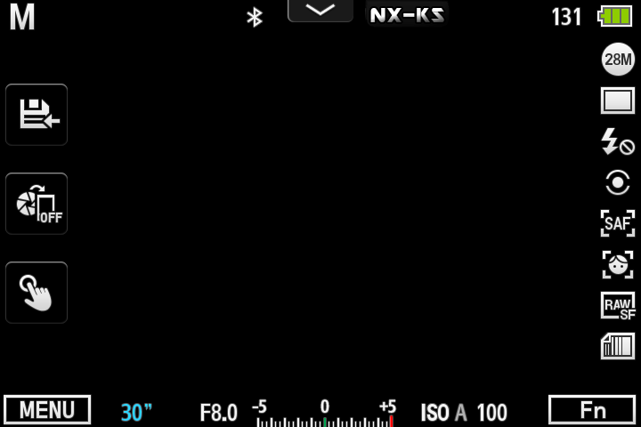

# NXConnectForNX500

**把三星 NX500 相机连上 Android 手机** —— 浏览 SD 卡、下载照片与 RAW、实时取景、
遥控快门与 B 门长曝光、**镜像相机屏幕并用手机操作相机菜单**。

[](https://github.com/Katsiy/NXConnectForNX500/actions/workflows/build.yml)


---

## 它能做什么

| 功能 | 说明 |
|---|---|
| **相册浏览** | 按目录浏览相机 SD 卡，网格显示缩略图 |
| **下载** | 原图与 RAW（SRW）下载，带进度 |
| **实时取景** | 相机画面实时投到手机，两档画质（均为 720×480） |
| **快门** | 半按对焦 + 释放，可选静音快门 |
| **B 门长曝光** | App 内计时，可同时关闭相机屏幕省电/避免漏光 |
| **相机屏幕镜像** | **把相机自己的屏幕投到手机上，并能用手机按键操作相机菜单** —— 这是改曝光参数的唯一途径（见下） |
| **遥控按键** | 30 个按键（P/A/S/M、ISO、白平衡、测光、转盘……），映射自相机机身实体键 |
| **自动同步时间** | 连接后静默同步相机时钟 |


上图是**实时取景 + 相机屏幕叠加**：背景是实景，叠加在上面的是相机自己的参数菜单。
这样能一边看构图一边调参数。

再放一张相机拍摄界面本身的样子（中间的黑区就是取景画面本应显示的位置）：



---

## ⚠️ 前提：相机端必须装第三方组件

**原厂 NX500 固件不提供本 App 需要的一切接口。** 你必须在相机上安装下列组件之一
（它们都包含同一个遥控服务）：

- [nx-remote-controller-mod](https://github.com/mewlips/nx-remote-controller-mod)
- NX-KS2 / [NX-WA](https://github.com/WApaperplane/NXWA-nx500_modding) 这类整合包

装好后，相机上按 `MOBILE` 键即可启动服务，相机会开一个 Wi-Fi 热点。

**本仓库不包含、也不分发这些组件**，请自行从上游获取。
它们与本项目无隶属关系，各自以自己的许可证发布（详见 [NOTICE](NOTICE)）。

> ⚠️ 给相机写入第三方组件**可能使保修失效，并存在损坏设备的风险**。请自行评估。
> 本项目与三星无关联，未获其授权。

---

## 安装

1. 从 [Releases](https://github.com/Katsiy/NXConnectForNX500/releases) 下载 APK
2. 手机上允许"安装未知来源应用"，安装
3. 相机开热点 → 手机连上该热点 → 打开 App → 点"连接"

要求 **Android 7.0 (API 24) 及以上**。

**首次连接**：App 会自动搜索相机（UDP 广播 + 全段扫描兜底）。
搜不到可以手动填 IP —— 相机默认 `192.168.5.39`，但它是 DHCP 客户端，**地址可能变**。

---

## 已知限制（都是相机硬件的限制，不是"没做"）

这几条在开发过程中逐一实测确认过：

| 限制 | 原因 |
|---|---|
| **拿不到电量百分比** | 硬件不提供。`st bat get_soc` 返回 `ret=-1`，sysfs 只有一个无意义的 `capacity=1330` |
| **拿不到镜头信息** | MCB 总线被相机自身 App 占用，`st cap lens` 报 `Cann't execute capture command over MCB!` |
| **无法直接读写曝光参数** | 没有可用通路：`capdtm` 只能读到 1 个参数，`setusr`/`mcb` 无输出，也没有参数查询接口 |
| **所以改参数只能靠屏幕镜像** | 这是上面两条的直接后果 —— App 无法知道"现在是 ISO 800"，只能把相机屏幕投出来自己看 |
| **取景分辨率固定 720×480** | 相机只提供两档（`/liveview/get` 与 `/liveview/get_low`），没有第三档 |
| **相机端 HTTP 吞吐约 4.5~5 请求/秒** | 相机是单核，相机自身 App 常驻占 59% CPU。取景与屏幕镜像同时开时会分掉这个预算 |

**相机屏幕的"变化帧"需要整屏重绘，一次约 0.7 秒** —— 这是相机端的物理上限，
所以操作菜单时会有约半秒的延迟感，属正常现象。

---

## 从源码构建

```bash
git clone https://github.com/Katsiy/NXConnectForNX500.git
cd NXConnectForNX500/NXConnect

# 单元测试（110 个）
./gradlew :app:testDebugUnitTest

# 构建
./gradlew :app:assembleDebug
```

需要 **JDK 17+** 与 **Android SDK 35 / build-tools 35.0.0**。

**签名**：仓库不含签名密钥。没有 `keystore.properties` 时会自动回退到 debug 签名，
贡献者无需任何配置即可构建。想用自己的密钥：

```powershell
pwsh tools/make-keystore.ps1
```

---

## 没有相机时也能验证

`tools/` 下有离线工具，**不需要相机**：

```bash
# 模拟相机（双端口，含真实缩略图生成、快门后自动新增照片）
python tools/mock_camera.py

# 协议一致性自检
python tools/verify_mock_camera.py

# NV12 取景解码算法校验（Kotlin 实现 vs 标准 BT.601）
python tools/verify_nv12.py
```

`tools/camera/` 下是 **40 个真机诊断脚本**，需要相机在线。
它们假设相机端 telnet（23）与 FTP（21）可用 —— 那两个服务由相机端组件提供，不是原厂自带。

---

## 文档

| 文档 | 内容 |
|---|---|
| [docs/protocol.md](docs/protocol.md) | **协议契约全文** —— 端口架构、UDP 发现、NV12 两种布局、快门时序、CGI 约束。改协议层前必读 |
| [docs/osd-mirror.md](docs/osd-mirror.md) | 相机屏幕镜像的协议与实现要点 |
| [docs/osd-measurements.md](docs/osd-measurements.md) | OSD 的真机实测数据（含对照实验与结论修正过程） |
| [docs/feasibility-EFH.md](docs/feasibility-EFH.md) | 几个功能的可行性实测与结论（含做不了的） |
| [docs/camera-side-input-failure.md](docs/camera-side-input-failure.md) | 相机端按键注入为何失效（glibc ABI 问题，App 侧无解） |
| [CHANGELOG.md](CHANGELOG.md) | 版本变更 |
| [CONTRIBUTING.md](CONTRIBUTING.md) | 参与开发前请读 |

---

## 这个项目怎么来的

NX500 的遥控协议资料散落在各处，且大多已过时或语焉不详。
本项目的做法是：**读上游开源实现的源码理解协议语义 → 在真机上逐项验证 →
把实测数字写进代码注释和单元测试**。

所以代码里会有很多看似"奇怪"的常量和解释它们来历的注释
（例如 OSD 的长度公式 `12 + N × 12808`）。那些都是实测值，
单元测试里也有对应的**数学自检**，请不要"顺手优化"掉。

---

## 许可证

**AGPL-3.0**（或更新版本）。详见 [LICENSE](LICENSE) 与 [NOTICE](NOTICE)。

之所以用 AGPL：本项目的协议知识来自以 AGPL-3.0 发布的上游项目
（`nx-remote-controller-mod`、`NX-WA`）。实现代码是本项目独立编写的，
但遵循同一许可证发布。

---

## 免责声明

本项目与 **Samsung Electronics** 无任何关联，未获其授权、赞助或认可。
"Samsung"、"NX500" 等名称是其各自所有者的商标，仅用于说明兼容性。

使用本项目需要给相机写入第三方组件，**这可能使保修失效，并存在损坏设备（变砖）
的风险**。作者不对任何设备损坏、数据丢失或其他损失负责。

本程序按"有用"的目的分发，但**不提供任何担保**，甚至不包含适销性或特定用途
适用性的默示担保。请自行评估风险。
