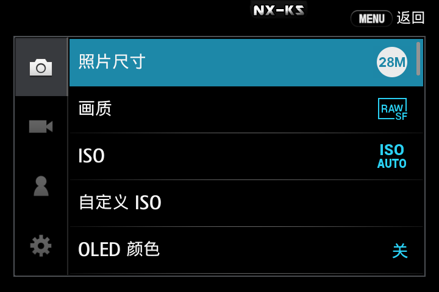

# NXConnectForNX500

**把三星 NX500 相机连上 Android 手机** —— 浏览 SD 卡、下载照片与 RAW、实时取景、
遥控快门与 B 门长曝光、**镜像相机屏幕并用手机操作相机菜单**。

> **机型兼容性**
> NX1 的底层与 NX500 基本一致，因此应该也可直接使用本项目。
> NX300、NX3000 等机型尚未适配；若刷入了支持 Telnet 的固件也可尝试，但无法保证体验。
>
> **v0.16.0 起会按机型自适应**：OSD 帧尺寸（NX1/NX500 是 720×480，NX300 是 800×480）、
> 曝光补偿键的 keysym（NX1 用 `XF86WWW`，其余 `XF86Reload`）、
> 自定义模式与 Wi-Fi 模式键的可见性。
> 其中 **NX500 已真机实测**；NX1 / NX300 的规格来自上游源码与官方发布包考证，
> **尚未在本项目里真机验证**。遇到问题欢迎开 issue，附上机型、固件版本与诊断脚本输出，
> 详见 [docs/model-compatibility.md](docs/model-compatibility.md)。

[](https://github.com/Katsiy/NXConnectForNX500/actions/workflows/build.yml)


---

## 它能做什么


| 功能 | 说明 |
|---|---|
| **相册浏览** | 按目录浏览相机 SD 卡，网格显示缩略图 |
| **下载** | 原图与 RAW（SRW）下载，带进度 |
| **实时取景** | 相机画面实时投到手机，两档画质 |
| **快门** | 对焦 + 释放 |
| **B 门长曝光** | App 内计时，可同时关闭相机屏幕省电/避免漏光 |
| **相机屏幕镜像** | **把相机自己的屏幕投到手机上，并能用手机按键操作相机菜单**  |
| **遥控按键** | 30 个按键（P/A/S/M、ISO、白平衡、测光、转盘……），映射自相机机身实体键 |
| **自动同步时间** | 连接后静默同步相机时钟 |

程序主界面


照片传输界面


遥控界面


相机屏幕镜像（OSD）—— 这是**相机自己的屏幕**经 OSD 接口取回来的样子：



左侧是分组标签，右侧是「照片尺寸 / 画质 / ISO / 自定义 ISO / OLED 颜色」。
App 把这张画面叠加在实时取景之上，于是你能一边看构图、一边用手机按键在相机菜单里改参数。

## ⚠️ 前提：相机端必须装第三方组件

**原厂 NX500 固件不提供本 App 需要的一切接口。** 你必须在相机上安装下列组件之一
（它们都包含同一个遥控服务）：

- [nx-remote-controller-mod](https://github.com/mewlips/nx-remote-controller-mod)
- NX-KS（https://github.com/ottokiksmaler/nx500_nx1_modding） / [NX-WA](https://github.com/WApaperplane/NXWA-nx500_modding) 这类整合包

装好后，相机上开启Telnet并连接WiFi即可启动服务。

**本仓库不包含、也不分发这些组件**，请自行从上游获取。
它们与本项目无隶属关系，各自以自己的许可证发布（详见 [NOTICE](NOTICE)）。

> ⚠️ 给相机写入第三方组件**可能使保修失效，并存在损坏设备的风险**。请自行评估。
> 本项目与三星无关联，未获其授权。

---

## 安装

1. 从 [Releases](https://github.com/Katsiy/NXConnectForNX500/releases) 下载 APK
2. 手机上允许"安装未知来源应用"，安装
3. 相机开热点 → 手机连上该热点 → 打开 App → 点"连接"

要求 **Android 7.0 (API 24) 及以上**。

**首次连接**：App 会自动搜索相机（UDP 广播 + 全段扫描兜底）。
搜不到可以手动填 IP。

---

## 已知限制（都是相机硬件的限制，不是"没做"）

这几条在开发过程中逐一实测确认过：

| 限制 | 原因 |
|---|---|
| **拿不到电量百分比** | 硬件不提供。`st bat get_soc` 返回 `ret=-1`，sysfs 只有一个无意义的 `capacity=1330` |
| **拿不到镜头信息** | MCB 总线被相机自身 App 占用，`st cap lens` 报 `Cann't execute capture command over MCB!` |
| **App 目前靠屏幕镜像改参数** | 相机其实支持直读直写（见下条），但 App 走的是 HTTP，`st` 命令要通过 telnet 才能用 |
| ~~无法读写曝光参数~~ → **实际可以** | 2026-10-22 实测推翻：`st cap capdtm getusr ISO` / `getvar TV` / `setvar EVC 0x0e 4` 全部可用。之前的"只能读 1 个参数"是**参数名带了 `USERDATA_` 前缀**导致的误判。参数表与编码说明见 [docs/capdtm-reference.md](docs/capdtm-reference.md) |
| **取景分辨率固定**（NX1/NX500 720×480，NX300 800×480） | 相机只提供两档（`/liveview/get` 与 `/liveview/get_low`），没有第三档 |
| **相机端 HTTP 吞吐约 4.5~5 请求/秒** | 相机是单核，相机自身 App 常驻占 59% CPU。取景与屏幕镜像同时开时会分掉这个预算 |

**相机屏幕的"变化帧"需要整屏重绘，一次约 0.7 秒** —— 这是相机端的物理上限，
所以操作菜单时会有约半秒的延迟感，属正常现象。

---

## 从源码构建

```bash
git clone https://github.com/Katsiy/NXConnectForNX500.git
cd NXConnectForNX500/NXConnect

# 单元测试（132 个）
./gradlew :app:testDebugUnitTest

# 构建
./gradlew :app:assembleDebug
```

需要 **JDK 17+** 与 **Android SDK 35 / build-tools 35.0.0**。

**签名**：仓库不含签名密钥。没有 `keystore.properties` 时会自动回退到 debug 签名，
贡献者无需任何配置即可构建。想用自己的密钥：

```powershell
pwsh tools/make-keystore.ps1
```

---

## 没有相机时也能验证

`tools/` 下有离线工具，**不需要相机**：

```bash
# 模拟相机（双端口，含真实缩略图生成、快门后自动新增照片、OSD 屏幕镜像）
python tools/mock_camera.py

# 协议一致性自检
python tools/verify_mock_camera.py

# NV12 取景解码算法校验（Kotlin 实现 vs 标准 BT.601）
python tools/verify_nv12.py

# 多机型 OSD 校验：分别以 NX500 / NX1 / NX300 身份起 mock，
# 检查帧头尺寸、块数（108 / 120）、长度公式与增量行为
python tools/verify_mock_osd.py
```

> `mock_camera.py` 的 `--model` 参数会改变 OSD 与 `camera/info` 的机型相关字段，
> 可以用它在没有 NX1 / NX300 的情况下回归多机型适配：
> `python tools/mock_camera.py --model NX300`

`tools/camera/` 下是 **40 个真机诊断脚本**，需要相机在线。
它们假设相机端 telnet（23）与 FTP（21）可用 —— 那两个服务由相机端组件提供，不是原厂自带。

---

## 文档

| 文档 | 内容 |
|---|---|
| [docs/protocol.md](docs/protocol.md) | **协议契约全文** —— 端口架构、UDP 发现、NV12 两种布局、快门时序、CGI 约束。改协议层前必读 |
| [docs/osd-mirror.md](docs/osd-mirror.md) | 相机屏幕镜像的协议与实现要点 |
| [docs/osd-measurements.md](docs/osd-measurements.md) | OSD 的真机实测数据（含对照实验与结论修正过程） |
| [docs/feasibility-EFH.md](docs/feasibility-EFH.md) | 几个功能的可行性实测与结论（含做不了的） |
| [docs/camera-side-input-failure.md](docs/camera-side-input-failure.md) | 相机端按键注入为何失效（glibc ABI 问题，App 侧无解） |
| [CHANGELOG.md](CHANGELOG.md) | 版本变更 |
| [CONTRIBUTING.md](CONTRIBUTING.md) | 参与开发前请读 |

---

## 这个项目怎么来的

NX500 的遥控协议资料散落在各处，且大多已过时或语焉不详。
本项目的做法是：**读上游开源实现的源码理解协议语义 → 在真机上逐项验证 →
把实测数字写进代码注释和单元测试**。

所以代码里会有很多看似"奇怪"的常量和解释它们来历的注释
（例如 OSD 的长度公式 `12 + N × 12808`）。那些都是实测值，
单元测试里也有对应的**数学自检**，请不要"顺手优化"掉。

---

## 许可证

**AGPL-3.0**（或更新版本）。详见 [LICENSE](LICENSE) 与 [NOTICE](NOTICE)。

之所以用 AGPL：本项目的协议知识来自以 AGPL-3.0 发布的上游项目
（`nx-remote-controller-mod`、`NX-WA`）。实现代码是本项目独立编写的，
但遵循同一许可证发布。

---

## 免责声明

本项目与 **Samsung Electronics** 无任何关联，未获其授权、赞助或认可。
"Samsung"、"NX500" 等名称是其各自所有者的商标，仅用于说明兼容性。

使用本项目需要给相机写入第三方组件，**这可能使保修失效，并存在损坏设备（变砖）
的风险**。作者不对任何设备损坏、数据丢失或其他损失负责。

本程序按"有用"的目的分发，但**不提供任何担保**，甚至不包含适销性或特定用途
适用性的默示担保。请自行评估风险。
